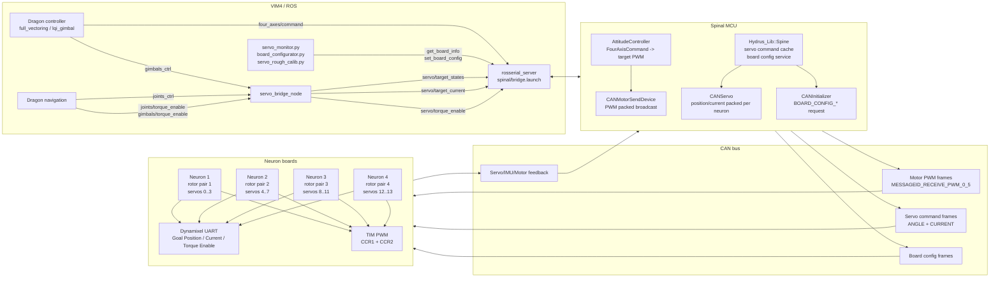

# Hardware Framework

This note summarizes the current Dragon hardware communication framework from the onboard computer (VIM4) to Spinal and Neuron boards. It focuses on the real-machine path:

```text
VIM4 ROS nodes <=> rosserial bridge <=> Spinal MCU <=> CAN bus <=> Neuron boards <=> rotors / servos
```

The current implementation uses separate high-rate actuator command paths for rotors and servos, plus low-rate board configuration services for fine servo setup such as homing offset, external encoder mode, PID gain, current limit, and resolution ratio.

## Framework Diagram



## Key Files

| Layer | File | Role |
|---|---|---|
| Dragon launch | `robots/dragon/launch/bringup.launch` | starts `servo_bridge_node` under the robot namespace |
| ROS to Spinal transport | `aerial_robot_nerve/spinal/launch/bridge.launch` | starts `rosserial_server` in serial or UDP mode |
| Servo bridge | `aerial_robot_model/src/servo_bridge/servo_bridge.cpp` | converts ROS `JointState` commands to Spinal servo messages |
| Spinal main actuator bridge | `aerial_robot_nerve/spinal/mcu_project/lib/Hydrus_Lib/Spine/spine.cpp` | receives rosserial commands, sends CAN commands, publishes servo feedback |
| Spinal motor CAN | `aerial_robot_nerve/spinal/mcu_project/lib/Hydrus_Lib/CANDevice/motor/can_motor.cpp` | packs rotor PWM commands for CAN broadcast |
| Spinal servo CAN | `aerial_robot_nerve/spinal/mcu_project/lib/Hydrus_Lib/CANDevice/servo/can_servo.cpp` | packs servo position/current/enable commands |
| Spinal config CAN | `aerial_robot_nerve/spinal/mcu_project/lib/Hydrus_Lib/CANDevice/initializer/can_initializer.cpp` | sends low-rate board configuration requests |
| Neuron motor | `aerial_robot_nerve/neuron/neuronlib/Motor/motor.cpp` | decodes PWM CAN frames and writes timer CCR registers |
| Neuron servo CAN | `aerial_robot_nerve/neuron/neuronlib/Servo/servo.cpp` | decodes servo CAN frames and forwards commands to Dynamixel driver |
| Neuron Dynamixel | `aerial_robot_nerve/neuron/neuronlib/Servo/Dynamixel/dynamixel_serial.cpp` | writes Dynamixel control table registers |
| Dragon servo map | `robots/dragon/config/quad/v1_5_202601/Servo.yaml` | maps joint/gimbal names to global servo indices and unit scales |

## VIM4 to Spinal

`aerial_robot_nerve/spinal/launch/bridge.launch` starts a `rosserial_server` node:

```xml
<arg name="mode" default="serial" />
<arg name="serial_port" default="/dev/ttyUSB0" />
<arg name="serial_baud" default="921600" />
<arg name="udp_port" default="12345" />
<arg name="udp_addr" default="192.168.25.238" />
```

In serial mode, VIM4 communicates with the Spinal MCU through `rosserial_server/serial_node` at 921600 baud. In UDP mode, it uses `rosserial_server/udp_socket_node` with the configured address and port. The bridge carries normal ROS topics and services to/from the embedded rosserial node on Spinal.

Important ROS interfaces crossing this boundary:

| Direction | ROS name | Type | Meaning |
|---|---|---|---|
| VIM4 -> Spinal | `four_axes/command` | `spinal/FourAxisCommand` | rotor thrust and attitude command consumed by Spinal attitude controller |
| VIM4 -> Spinal | `servo/target_states` | `spinal/ServoControlCmd` | servo target position, raw bit values |
| VIM4 -> Spinal | `servo/target_current` | `spinal/ServoControlCmd` | servo target current, raw bit values |
| VIM4 -> Spinal | `servo/torque_enable` | `spinal/ServoTorqueCmd` | servo torque enable/disable |
| VIM4 <-> Spinal | `get_board_info` | `spinal/GetBoardInfo` | board, servo, and config readback |
| VIM4 -> Spinal | `set_board_config` | `spinal/SetBoardConfig` | low-rate board/servo configuration |
| Spinal -> VIM4 | `servo/states` | `spinal/ServoStates` | servo feedback: position, velocity, current/load, temp, error |
| Spinal -> VIM4 | `servo/torque_states` | `spinal/ServoTorqueStates` | torque-enable state readback |
| Spinal -> VIM4 | `uav_info` | `spinal/UavInfo` | board/model information used by ROS-side nodes |

## Servo Bridge

Dragon starts `aerial_robot_model/servo_bridge_node` from `robots/dragon/launch/bringup.launch`. The bridge reads `servo_controller` parameters and creates one group per servo group, currently `joints` and `gimbals`.

ROS-side command inputs:

| Input | Type | Meaning |
|---|---|---|
| `joints_ctrl` | `sensor_msgs/JointState` | target joint positions in radians; optional `effort` |
| `gimbals_ctrl` | `sensor_msgs/JointState` | target gimbal positions in radians; optional `effort` |
| `joints_torque_ctrl` | `sensor_msgs/JointState` | current/torque command only, legacy/current-only path |
| `gimbals_torque_ctrl` | `sensor_msgs/JointState` | current/torque command only, legacy/current-only path |
| `joints/torque_enable` | `std_srvs/SetBool` | enable/disable joint servo torque |
| `gimbals/torque_enable` | `std_srvs/SetBool` | enable/disable gimbal servo torque |

Bridge outputs to Spinal:

| Output | Type | Meaning |
|---|---|---|
| `servo/target_states` | `spinal/ServoControlCmd` | target position, raw Dynamixel-like bit |
| `servo/target_current` | `spinal/ServoControlCmd` | target current, raw bit |
| `servo/torque_enable` | `spinal/ServoTorqueCmd` | torque enable flag |

`servo_bridge` is also the main unit-conversion boundary. It uses `angle_scale`, `velocity_scale`, `torque_scale`, `angle_sgn`, and `zero_point_offset` from `robots/dragon/config/quad/v1_5_202601/Servo.yaml` to convert:

```text
radian position -> raw position bit
raw servo position -> radian feedback
raw velocity -> rad/s feedback
Nm effort/current estimate -> raw current bit
raw current/load -> effort feedback
```

The current embedded Spinal/Neuron path mostly stores and transmits raw register-style values. Avoid duplicating SI-unit conversion in Spinal unless all scale/sign/offset constants are intentionally moved into firmware.

## Spinal Servo Path

In `Hydrus_Lib/Spine/spine.cpp`, Spinal subscribes to:

```cpp
servo/target_states   -> servoPositionCallback()
servo/target_current  -> servoCurrentCallback()
servo/torque_enable   -> servoTorqueControlCallback()
```

The callbacks only update Spinal-side cached servo objects:

```text
ServoControlCmd.index[i] + angles[i] on servo/target_states
  -> setGoalPosition(raw_position)

ServoControlCmd.index[i] + angles[i] on servo/target_current
  -> setGoalCurrent(raw_current)

ServoTorqueCmd.index[i] + torque_enable[i]
  -> setTorqueEnable(bool)
```

The cached values are sent to Neuron boards later in the Spinal CAN send loop.

### Servo CAN Packing

`CANServo::sendData()` sends two CAN messages per addressed Neuron:

```text
MESSAGEID_RECEIVE_SERVO_ANGLE
MESSAGEID_RECEIVE_SERVO_CURRENT
```

The position frame packs up to 4 servo position commands in one classic CAN frame:

```text
target_angle[i] = bit15 ack flag + bit14..0 signed 15-bit goal position
```

The current frame packs up to 4 current commands and the torque enable bit:

```text
target_current[i] = bit15 torque_enable + bit14..0 signed 15-bit goal current
```

This split exists because classic CAN payload is 8 bytes. Four `uint16` values already fill one frame, so position and current/enable are sent as separate frames.

### Neuron Servo Decode

`aerial_robot_nerve/neuron/neuronlib/Servo/servo.cpp` receives the CAN frames:

```text
ANGLE frame:
  int15 -> int32 goal_pos
  setGoalPosition(goal_pos)

CURRENT frame:
  int15 -> int16 goal_current
  setGoalCurrent(goal_current)
  setTorque(servo_index, torque_enable)
```

The Neuron Dynamixel driver then writes actual Dynamixel registers:

| Command | Dynamixel register | Code path |
|---|---|---|
| goal position | `CTRL_GOAL_POSITION` / `0x74` / 4 bytes | `cmdSyncWriteGoalPosition()` |
| goal current | `CTRL_GOAL_CURRENT` / `0x66` / 2 bytes | `cmdSyncWriteGoalCurrent()` |
| torque enable | `CTRL_TORQUE_ENABLE` / `0x40` / 1 byte | `cmdWriteTorqueEnable()` |

Neuron does not write the Dynamixel UART every time a CAN command arrives. `DynamixelSerial::update()` pushes `INST_SET_GOAL_COMMAND` at `SET_COMMAND_DU = 20 ms`, so current code writes goal position/current to Dynamixel at about 50 Hz.

## Spinal Rotor Path

Dragon controllers publish rotor thrust through:

```text
four_axes/command : spinal/FourAxisCommand
```

`DragonFullVectoringController` fills `base_thrust` from `target_base_thrust_`, and Spinal `AttitudeController::fourAxisCommandCallback()` stores it in `base_thrust_term_`.

Spinal later computes:

```text
target_thrust[i] -> target_pwm[i] = convert(target_thrust[i])
target_pwm is clamped between min_duty and max_duty
```

`Hydrus_Lib::Spine` then converts each motor duty rate to a 10-bit-ish PWM command:

```cpp
float pwm_rate = controller_->getTargetPwm(i);
uint16_t pwm_bit = pwm_rate * 2000 - 1000;
neuron_[i].can_motor_.setPwm(pwm_bit);
```

`CANMotorSendDevice` packs up to 6 motor PWM commands into one 8-byte CAN frame:

```text
MESSAGEID_RECEIVE_PWM_0_5
MESSAGEID_RECEIVE_PWM_6_11  // used only if more than 6 motor entries exist
```

For Dragon's 4-Neuron setup, one broadcast frame is enough. Each Neuron uses its `slave_id` to extract its own PWM value.

On the Neuron:

```cpp
setSyncPwm(pwm)
raw_val = (pwm + 1000) / 2000 * timer_period
CCR1 = raw_val
CCR2 = raw_val  // STM32G4 path
```

So the current G4 Neuron motor implementation drives two PWM outputs with the same command. This matches Dragon's "one Neuron per rotor pair" architecture: one CAN motor command controls one physical rotor pair on that Neuron.

## Frequencies

| Link | Current behavior |
|---|---|
| VIM4 -> Spinal rosserial | event/topic driven over serial 921600 baud or UDP, depending on `bridge.launch` |
| Spinal main CAN send loop | designed around 1 ms tick |
| Spinal motor CAN | even millisecond branch, about 500 Hz broadcast |
| Spinal servo CAN | odd millisecond branch, round-robin across Neurons |
| Dragon servo CAN per Neuron | about `500 Hz / 4 = 125 Hz` for 4 Neurons |
| Neuron -> Dynamixel goal position/current | `SET_COMMAND_DU = 20 ms`, about 50 Hz |
| Spinal -> ROS `servo/states` | `SERVO_PUB_INTERVAL = 20 ms`, about 50 Hz |
| Spinal -> ROS `servo/torque_states` | `SERVO_TORQUE_PUB_INTERVAL = 1000 ms`, about 1 Hz |

## Dragon Actuator Allocation

Dragon currently has:

```text
4 links
8 gimbal servos
4 rotor pairs
6 inter-link joints
```

The current architecture is 4 Neurons, not 3 Neurons plus an extra Spinal rotor. Spinal initializes one `CANMotor` and one `CANServo` per discovered Neuron and calls:

```cpp
controller_->setMotorNumber(slave_num_);
```

That makes the Spinal controller motor count equal to the number of Neuron boards. Each Neuron receives one motor PWM command and applies it to two PWM channels, controlling one rotor pair.

The servo global index allocation from `Servo.yaml` is:

| Neuron / slave | Rotor | Servo global indices |
|---|---|---|
| slave 1 | rotor pair 1 | `0 joint1_yaw`, `1 joint1_pitch`, `2 gimbal1_pitch`, `3 gimbal1_roll` |
| slave 2 | rotor pair 2 | `4 joint2_yaw`, `5 joint2_pitch`, `6 gimbal2_pitch`, `7 gimbal2_roll` |
| slave 3 | rotor pair 3 | `8 joint3_yaw`, `9 joint3_pitch`, `10 gimbal3_pitch`, `11 gimbal3_roll` |
| slave 4 | rotor pair 4 | `12 gimbal4_pitch`, `13 gimbal4_roll` |

The first three Neurons carry both the inter-link joints and the local gimbal pair. The fourth link has only the gimbal pair, because there is no fourth inter-link joint pair.

## Feedback Flow

Neuron servo feedback is sent through `Servo::sendData()` as `CANServoData`:

```text
angle / target angle acknowledgement
temperature
moving flag
force servo disable flag
present current
hardware error status
```

Spinal receives this in `CANServo::receiveDataCallback()`, updates its board/servo cache, and publishes:

```text
servo/states       : 50 Hz
servo/torque_states: 1 Hz
```

`servo_bridge` consumes `servo/states`, converts raw values back into ROS `sensor_msgs/JointState`, and publishes:

```text
/dragon/joint_states
```

That topic is the ROS-side joint/gimbal feedback used by navigation, controllers, monitors, and calibration tools.

## Board Configuration and Fine Servo Operations

Fine operations are not high-rate commands. They use `set_board_config` and `get_board_info`.

`get_board_info` returns `spinal/BoardInfo[]`, which contains `spinal/ServoInfo[]`:

```text
id
p_gain / i_gain / d_gain
profile_velocity
current_limit
send_data_flag
external_encoder_flag
joint_resolution
servo_resolution
```

`set_board_config` supports operations such as:

| Command | Data | Effect |
|---|---|---|
| `SET_SERVO_HOMING_OFFSET = 2` | `[slave_id, servo_index, calib_value]` | sets servo middle/zero calibration |
| `SET_SERVO_PID_GAIN = 3` | `[slave_id, servo_index, p, i, d]` | writes Dynamixel position PID gains |
| `SET_SERVO_PROFILE_VEL = 4` | `[slave_id, servo_index, profile_vel]` | writes Dynamixel profile velocity |
| `SET_SERVO_SEND_DATA_FLAG = 5` | `[slave_id, servo_index, flag]` | controls whether feedback is sent |
| `SET_SERVO_CURRENT_LIMIT = 6` | `[slave_id, servo_index, current_limit]` | writes current limit |
| `SET_SERVO_EXTERNAL_ENCODER_FLAG = 9` | `[slave_id, servo_index, flag]` | switches internal/external encoder handling |
| `SET_SERVO_RESOLUTION_RATIO = 10` | `[slave_id, servo_index, joint_resolution, servo_resolution]` | configures pulley/external encoder scale |
| `SET_SERVO_PULLEY_SKIP_THRESH = 12` | `[slave_id, thresh]` | configures pulley skip threshold |

There is also a WIP/hidden round-offset command:

```text
command = 11
data = [slave_id, servo_index, raw_ref]
```

`servo_rough_calib.py` uses this to correct 4096-count wrap/round offset at startup when a joint angle differs too much from the expected calibration pose.

### Homing Offset Behavior

For internal Dynamixel encoder mode:

```text
SET_SERVO_HOMING_OFFSET
  -> neuron setHomingOffset()
  -> reset homing offset
  -> read present position
  -> compute homing_offset = calib_value - present_position
  -> write Dynamixel CTRL_HOMING_OFFSET
```

For external encoder mode:

```text
SET_SERVO_HOMING_OFFSET
  -> update neuron joint_offset_
  -> encoder_handler_.setOffset(joint_offset_)
  -> write neuron flash
```

External encoder mode changes the runtime position source. Neuron reads the external encoder as joint position and uses the difference between external encoder position and Dynamixel internal position to maintain `internal_offset_` and detect pulley skip.

## Direct Servo Path

There is another firmware path under:

```text
aerial_robot_nerve/spinal/mcu_project/lib/Jsk_Lib/servo
```

That path directly drives servos from Spinal over UART/Dynamixel or Kondo drivers. It includes TTL half-duplex handling and subscribes to `servo/target_states` and `servo/torque_enable` directly.

Dragon's current normal hardware path is different:

```text
VIM4 -> Spinal rosserial -> Spinal CAN -> Neuron -> Dynamixel UART
```

So the direct-servo path is useful context and compatibility code, but the Dragon gimbal/joint flow described above is the Neuron path.

## Design Notes for Future Unified Servo Command

The current ROS/Spinal command interface splits position and current:

```text
servo/target_states
servo/target_current
servo/torque_enable
```

A future unified command could reduce this to:

```text
servo/target_states  // index + position + velocity + current/effort
servo/torque_enable  // safety enable/disable
```

Two constraints matter:

1. Classic CAN is limited to 8-byte payloads. Moving from current 15-bit position/current to `int32 position`, `int32 velocity`, and `int16 current` requires a new multi-frame CAN packing scheme.
2. Unit conversion is currently centralized in `servo_bridge`. Spinal/Neuron mostly use raw/fixed-point/register values. Keeping SI-unit conversion on VIM4/servo_bridge avoids duplicating robot-specific scale constants in embedded firmware.

For MIT-like control, the closed loop should run on Neuron or Spinal rather than VIM4. Neuron is the best long-term location because it is closest to Dynamixel UART and external encoder feedback.
